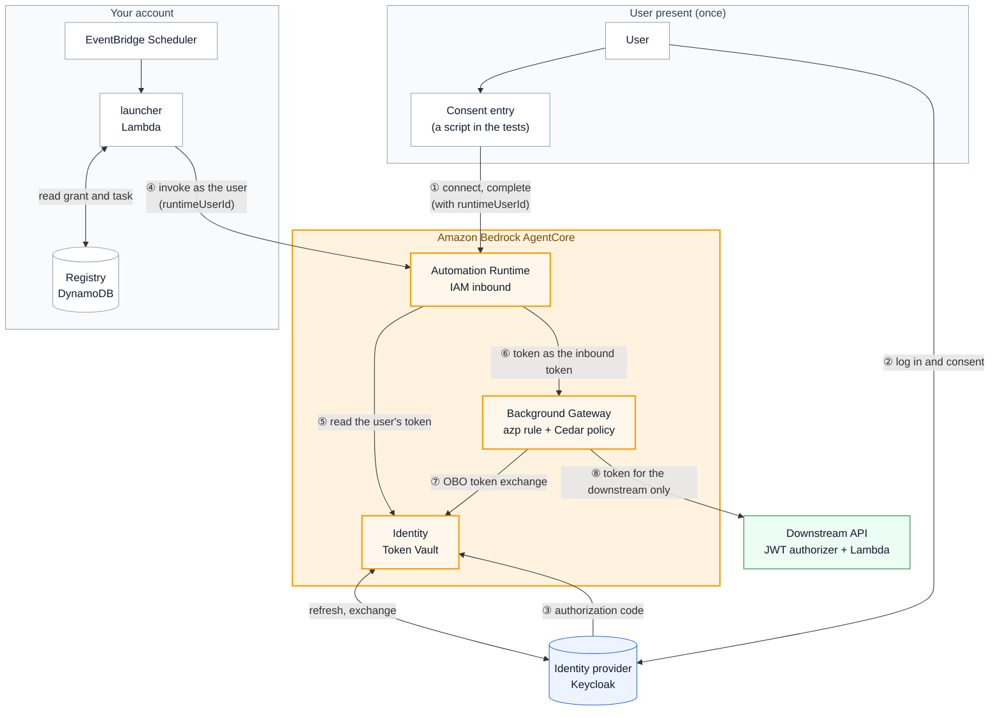
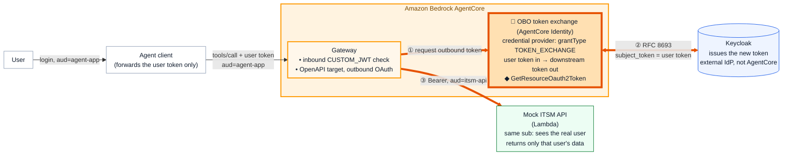
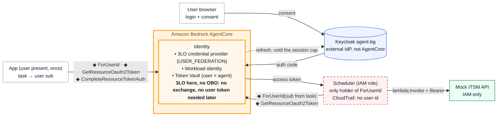
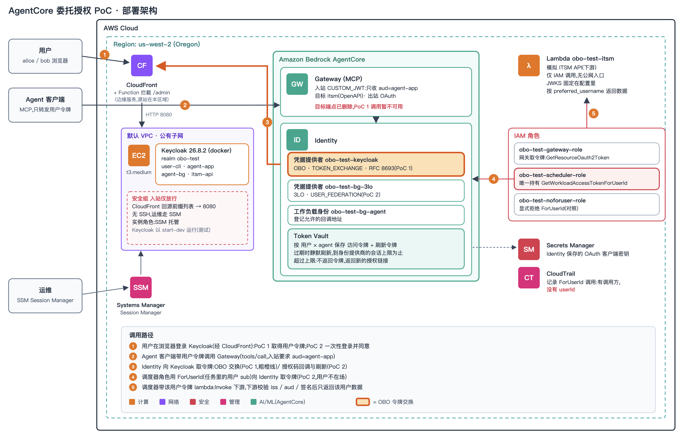

# AgentCore delegated-auth PoC

English | [简体中文](README.zh-CN.md)

Proofs of concept for letting an agent act for a user on Amazon Bedrock AgentCore, whether or not the user is present:

1. **PoC 1, user present: OBO token exchange.** An agent calls a downstream API through AgentCore Gateway. The gateway exchanges the user's token for a downstream token on every request, so the downstream sees the real user.
2. **PoC 2, user absent: 3LO + Token Vault.** The user consents once. A scheduler later fetches that user's token from AgentCore Identity's Token Vault with no user session, under a hard expiry the identity provider controls.
3. **v1, the unattended path on AgentCore Runtime.** EventBridge Scheduler triggers a launcher that checks a registry and invokes an automation Runtime with `runtimeUserId`. The Runtime reads the user's token from the Vault and calls a background gateway with an `azp` rule, its own OBO exchange client and a Cedar policy. Grant, use, revocation and audit were each tested.

The second PoC simulates a pattern from workspace platforms: a per-user authentication anchor, session forwarding to workspaces, and a server-held refresh credential that lets unattended automations run until a hard expiry. This repo maps that pattern onto AgentCore and measures where it holds and where it leaks.

Status: experimental. Not production code. License: MIT-0 (see `LICENSE`). Everything was run in one account and one region (us-west-2) with Keycloak as the identity provider, and most checks were run once: read the numbers as measurements, not benchmarks. The v1 design and results are written in Chinese: `docs/design.zh-CN.md` and `docs/results-v1.md`. The design contains items that were not built; the results file says what was tested.

## v1 architecture



- **Grant (user present, once).** The consent entry invokes the Runtime with `runtimeUserId` (connect, then complete). The Runtime calls Identity, because a caller cannot ask for a workload token for a Runtime's managed workload identity, and Vault entries are per workload identity.
- **Use (user absent).** Scheduler, launcher (checks the registry), Runtime (reads the Vault), background gateway (`azp` rule, OBO exchange with its own client, Cedar default deny), downstream. No principal holds `GetWorkloadAccessTokenForUserId`.
- **Why some code is self-built.** Only the launcher and a small fixed agent inside the Runtime. By the documentation, Harness and the Gateway 3LO targets and consent portal need a JWT at inbound, so no managed component fetches a user's token while the user is absent.

## Architecture of PoC 1 and 2

Orange = an AgentCore feature; the thick orange path is OBO (the groups are the AgentCore services). Blue = external identity provider. Green = downstream. Red dashed = the trust-critical caller and the audit gap. ◆ = an AgentCore API call.

**PoC 1: user present, OBO through the gateway**



**PoC 2: user absent, 3LO + Token Vault**



**Where OBO is.** OBO is the thick orange path in PoC 1 only: the gateway's outbound OAuth asks AgentCore Identity for a token (①), Identity exchanges the user's token at the IdP (RFC 8693, ②), and the downstream receives a token for itself that still carries the user's `sub` (③). It needs a live user token as `subject_token`, so it does not exist in PoC 2, where the user is absent. PoC 2 gets its token from a one-time consent (3LO) and the Token Vault instead.

| | PoC 1 | PoC 2 |
|---|---|---|
| Flow | OBO token exchange | 3LO authorization code + Token Vault |
| Credential provider | `obo-test-keycloak`, with an OBO config | `obo-test-bg-3lo`, no OBO config |
| Needs a user token at call time | yes, every call | no |
| Exchange per call | yes | no, the Vault serves a stored token and refreshes it |
| `azp` the downstream sees | `agent-app` | `agent-bg` |

AgentCore features used:

| Feature | Service | PoC |
|---|---|---|
| MCP gateway, inbound `CUSTOM_JWT` authorizer | Gateway | 1 |
| OpenAPI target with outbound OAuth `TOKEN_EXCHANGE` | Gateway | 1 |
| OAuth2 credential provider with OBO config (RFC 8693, `actorTokenContent=NONE`) | Identity | 1 |
| OAuth2 credential provider, 3LO (`USER_FEDERATION`) | Identity | 2 |
| Workload identity with allowed return URLs | Identity | 2 |
| Token Vault: tokens per user x agent, silent refresh | Identity | 2 |
| `GetWorkloadAccessTokenForUserId` | Identity | 2 |
| `GetResourceOauth2Token` | Identity | 1 (called by the gateway's service role), 2 |
| `CompleteResourceTokenAuth` | Identity | 2 |

v1 adds these (all measured, see `docs/results-v1.md`):

| Feature | Service |
|---|---|
| Runtime from a code zip, IAM inbound; `runtimeUserId` with `InvokeAgentRuntimeForUser`; the workload token arrives in the `WorkloadAccessToken` header | Runtime |
| `GetResourceOauth2Token` and `CompleteResourceTokenAuth` called from inside the Runtime | Identity |
| Inbound custom-claim rule on `azp` | Gateway |
| Outbound OBO with a separate exchange client | Gateway, Identity |
| Policy engine with a Cedar policy (LOG_ONLY, then ENFORCE) | Policy |

Not AgentCore: Keycloak (issues the tokens, decides consent and the session cap), the IAM roles, the launcher, the registry, the downstream API, CloudTrail. PoC 1 and 2 use no Runtime or Policy. No version uses Memory, Runtime Instances, the consent portal or Harness.

**AWS deployment view (us-west-2)**

[](docs/architecture-aws.svg)

Everything runs in one account and one region. Keycloak stands in for the enterprise IdP on a single EC2 instance behind CloudFront (its security group admits only CloudFront origin traffic; there is no SSH and administration goes through Systems Manager). The mock downstream is a Lambda with no public endpoint. The gateway target of PoC 1 currently points at an endpoint that was removed, so only PoC 2 runs end to end in this deployment; the picture marks that. Click the image for the vector version. The picture shows the first two PoCs. v1 adds, in the same account and region: an automation Runtime, a launcher Lambda with its EventBridge Scheduler role, a DynamoDB registry, a background gateway with a policy engine, a token-gated HTTP API in front of the same Lambda, and a CloudTrail trail for Runtime data events.

**Pattern → AgentCore mapping**

| Pattern component | AgentCore mapping | Built here |
|---|---|---|
| Per-user auth anchor | IdP session + AgentCore workload identity | partly: no long-running per-user broker |
| Session forwarding to workspaces (user present) | Gateway OBO exchange per request | yes (PoC 1) |
| Server-held refresh credential | Token Vault, 3LO authorization-code flow | yes (PoC 2, v1) |
| Hard expiry, re-consent by the user | IdP refresh-token / session lifetime | yes (PoC 2, v1) |
| Restrict who can use the credential | PoC 2: `ForUserId` only for the scheduler role. v1: no principal holds `ForUserId`; callers need `InvokeAgentRuntime` and `InvokeAgentRuntimeForUser` on one Runtime | yes |
| Unattended automations | EventBridge Scheduler, launcher, automation Runtime | yes (v1) |
| Workspaces (per-user compute) | AgentCore Runtime sessions or Runtime Instances | **no** |
| Consent UI and grant list | a console in front of the registry | **no** (a script stands in) |

## Layout

```
poc/          kc_check.py   manual Keycloak token exchange and direct downstream checks
              e2e.py        PoC 1: MCP calls through the gateway as alice and bob
              bg3lo.py      PoC 2: setup / run / later (3LO consent, scheduler fetch, expiry)
              bg_test.py    "no user token" scenarios against the OBO gateway (E1-E4)
              cdp_login.mjs drives a Chrome (CDP) through login + consent
downstream/   index.mjs     mock ITSM API (Lambda): verifies JWT iss/exp/aud/signature, returns the caller's data
scripts/      keycloak-setup.sh, cleanup.sh   (PoC 1 and 2)
v1/           auto_agent/main.py   agent code inside the automation Runtime (connect, complete, use, gateway, probe)
              launcher/handler.py  launcher Lambda: checks the registry, invokes the Runtime with runtimeUserId
              deploy_*.sh          automation Runtime, launcher + registry, background gateway, downstream HTTP API
              setup_roles.sh, setup_trail.sh, keycloak-v1.sh, attach_policy.py
              p0_*.py p1_*.py p2_*.py p3_*.py   the checks behind docs/results-v1.md
              lib.py rt.py gw_authorizer.py gw_direct.py   helpers
docs/         setup.md, results.md (PoC 1 and 2, English), design.zh-CN.md and results-v1.md (v1, Chinese),
              architecture-aws.svg / .png (deployment of the first two PoCs)
LICENSE       MIT-0
```

## Run

Prerequisites: an AWS account with AgentCore enabled, AWS CLI v2, Python 3, Node 22+, `uv` and `zip` (v1 bundles boto3 into the Runtime and Lambda packages), a Keycloak 26.2+ reachable over HTTPS (not `localhost`; AgentCore must reach the discovery URL), and Chrome started with `--remote-debugging-port=9222` for the consent step.

**PoC 1 and 2**

```bash
cp .env.example .env && $EDITOR .env && set -a && . ./.env && set +a
# follow docs/setup.md to create Keycloak clients, the OAuth2 credential providers,
# the gateway and target, the workload identity, and the IAM roles
python3 poc/e2e.py                 # PoC 1
python3 poc/bg3lo.py setup         # PoC 2: alice consents in the browser
python3 poc/bg3lo.py run           # scheduler fetches her token; negative tests
python3 poc/bg3lo.py later         # after the token lifespan, then after the session cap
```

**v1** needs the realm, the 3LO credential provider `obo-test-bg-3lo` and the Lambda `obo-test-itsm` from the setup above. Each script starts with a comment that lists what it needs; read it first.

```bash
# on the Keycloak host: exchange client, audience mapper, 120 s access token
BGEX_SECRET=... bash v1/keycloak-v1.sh
bash v1/deploy_downstream_api.sh        # prints the API URL: export DOWNSTREAM_URL
bash v1/deploy_auto_runtime.sh          # prints agentRuntimeId: export AUTO_RUNTIME_ID
aws bedrock-agentcore-control update-workload-identity --name "$AUTO_RUNTIME_ID" \
  --allowed-resource-oauth2-return-urls "$KC_ISSUER/.well-known/openid-configuration"
bash v1/deploy_launcher.sh
export BGEX_SECRET=... && bash v1/deploy_bg_gateway.sh    # prints the gateway id and URL: export BG_GATEWAY_ID
python3 v1/attach_policy.py LOG_ONLY    # later: ENFORCE
GATEWAY_URL=<gateway URL> bash v1/deploy_auto_runtime.sh   # re-run so the Runtime knows the gateway
python3 v1/p0_v2_runtime_grant.py       # grant through the Runtime (browser step), then use
python3 v1/p1_launcher.py               # Scheduler -> launcher -> Runtime -> Vault -> downstream
python3 v1/p2_gateway.py                # through the background gateway
```

The other checks (`p0_v1_identity_paths.py`, `p0_v2_iam.py` after `setup_roles.sh`, `p2_vault_freshness.py`, `p3_revoke.py` with `KC_ADMIN_CMD`, CloudTrail with `setup_trail.sh`) are described in `docs/results-v1.md`.

## Findings

**PoC 1 and 2** (`docs/results.md`)

- OBO works for a present user: the downstream sees the same `sub` with `aud` rewritten, and each user gets only their own data. The agent client never holds the downstream credential.
- Keycloak's standard token exchange does not write an `act` claim. The downstream can only tell an agent made the call from `azp`. Writing `act` needs Keycloak's preview delegation feature, which requires per-session user consent and so does not fit unattended runs.
- Without a user token, an agent's own client-credentials token is accepted by the gateway. An inbound restriction has to block it (v1 tested one on `azp`; `allowedClients` was not tested).
- Token Vault supports "consent once, run later": silent refresh works inside the IdP session limit, and after the limit the Vault returns no token and a new authorization URL.
- `GetWorkloadAccessTokenForUserId` takes an unverified user id string. Whoever holds that IAM permission can fetch the token of any user who has already consented. In PoC 2 the scheduler holds it; v1 removes the need.
- CloudTrail records the `ForUserId` call but not the user id passed.

**v1** (`docs/results-v1.md`, Chinese)

- The JWT path and the user-id path write different Token Vault entries (five spellings of the id were tried; none matched).
- A caller cannot ask for a workload token for a Runtime's managed workload identity, and Vault entries are per workload identity, so the grant also runs inside the Runtime. The session binding rejects another user's id.
- Invoking with `runtimeUserId` needs both `InvokeAgentRuntime` and `InvokeAgentRuntimeForUser`. No principal needs `GetWorkloadAccessTokenForUserId`.
- CloudTrail data events for `InvokeAgentRuntime` carry `runtimeSessionId` but not `runtimeUserId`. The launcher puts a hash of the user into the session id and writes a run record.
- Scheduler, launcher, Runtime, Vault and downstream work end to end. An expired, never-granted or disabled grant does not reach the downstream.
- Background gateway: the `azp` rule rejects another client's token; a separate exchange client makes the downstream see another `azp`; with Cedar in ENFORCE only the read tool is listed and callable.
- The gateway rejects inbound tokens with under about a minute of validity left, so a 60 s access token cannot be used behind it and 120 s works. The Vault refreshes at about a minute left, and the last minute of an IdP session is unusable.
- Revocation (ending the session, or deleting the consent) works. The Vault keeps serving its cached token until about a minute is left, so the window is up to about a minute; tokens already issued stay valid until `exp`.
- By the documentation (not tested): Harness and the Gateway 3LO targets and consent portal need a JWT at inbound, so no managed component fetches a user's token while the user is absent.
- Not tested: Entra ID OBO, real multi-day session caps and idle timeouts, per-group lengths, terms confirmation, Runtime Instances, private connectivity from the gateway to the downstream, explicit Deny and SCPs, a real consent UI.

## Security notes

- Secrets (`secrets.env`, `.env`) are git-ignored. Test users use the password grant for convenience; do not do that in production.
- The first PoCs' mock downstream has no public endpoint and verifies tokens itself. Keycloak runs in `start-dev` mode behind a CDN that blocks the admin paths. Treat both as test scaffolding.
- The v1 code (`v1/`) is test scaffolding and is not hardened. The automation Runtime agent keeps test-only modes (`probe`, and a `gateway` mode that takes tool names and arguments from the caller). The Runtime uses the PUBLIC network mode, its execution role uses a name-prefix wildcard on the workload identity and can read the credential provider's client secret, and the v1 downstream is a token-gated public HTTP API. Remove or restrict these before any real use.
- v1 has no cleanup script yet. Its resources are named `obo-test-v1*` or `obo_test_v1*`; delete them by hand when you are done.
- Every script creates or changes resources in your own AWS account and identity provider. Read it before you run it, and do not point it at an account you do not own.
- Run `scripts/cleanup.sh` (after reading it) when you are done; the test resources keep running and cost money.
