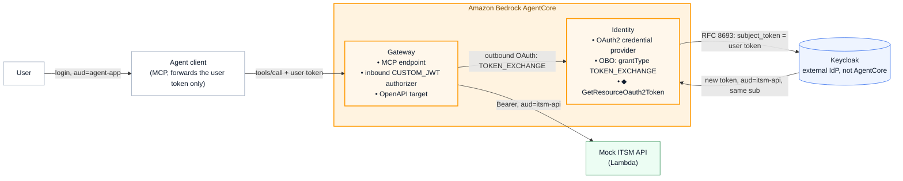
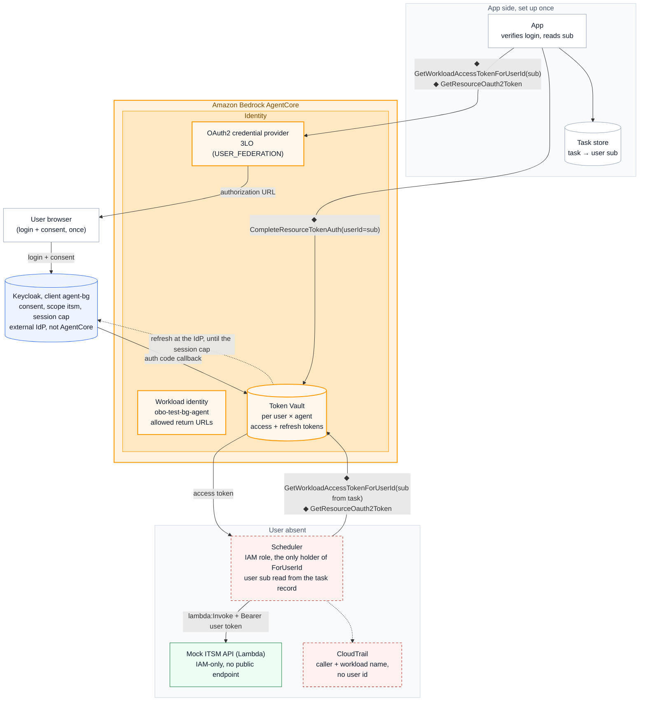

# AgentCore delegated-auth PoC

English | [简体中文](README.zh-CN.md)

Two proofs of concept for letting an agent act for a user on Amazon Bedrock AgentCore:

1. **User present: OBO token exchange.** An agent calls a downstream API through AgentCore Gateway. The gateway exchanges the user's token for a downstream token on every request, so the downstream sees the real user.
2. **User absent: 3LO + Token Vault.** The user consents once. A scheduler later fetches that user's token from AgentCore Identity's Token Vault with no user session, under a hard expiry the identity provider controls.

The second PoC simulates a pattern from workspace platforms: a per-user authentication anchor, session forwarding to workspaces, and a server-held refresh credential that lets unattended automations run until a hard expiry. This repo maps that pattern onto AgentCore and measures where it holds and where it leaks.

Status: private, experimental. Not production code.

## Architecture

Orange = an AgentCore feature (the groups are the AgentCore services). Blue = external identity provider. Green = downstream. Red dashed = the trust-critical caller and the audit gap. ◆ = an AgentCore API call.

**PoC 1: user present, OBO through the gateway**



**PoC 2: user absent, 3LO + Token Vault**



AgentCore features used:

| Feature | Service | PoC |
|---|---|---|
| MCP gateway, inbound `CUSTOM_JWT` authorizer | Gateway | 1 |
| OpenAPI target with outbound OAuth `TOKEN_EXCHANGE` | Gateway | 1 |
| OAuth2 credential provider with OBO config (RFC 8693, `actorTokenContent=NONE`) | Identity | 1 |
| OAuth2 credential provider, 3LO (`USER_FEDERATION`) | Identity | 2 |
| Workload identity with allowed return URLs | Identity | 2 |
| Token Vault: tokens per user x agent, silent refresh | Identity | 2 |
| `GetWorkloadAccessTokenForUserId` | Identity | 2 |
| `GetResourceOauth2Token` | Identity | 1 (called by the gateway's service role), 2 |
| `CompleteResourceTokenAuth` | Identity | 2 |

Not AgentCore: Keycloak (issues the tokens, decides consent and the session cap), the IAM roles, the task store, the downstream API, CloudTrail. AgentCore Runtime, Memory, Policy (Cedar) and the `GetWorkloadAccessTokenForJWT` path are not used.

| Pattern component | AgentCore mapping | Built here |
|---|---|---|
| Per-user auth anchor | IdP session + AgentCore workload identity | yes |
| Session forwarding to workspaces (user present) | Gateway OBO exchange per request | yes (PoC 1) |
| Server-held refresh credential | Token Vault, 3LO authorization-code flow | yes (PoC 2) |
| Hard expiry, re-consent by the user | IdP refresh-token / session lifetime | yes (PoC 2) |
| Restrict who can use the credential | IAM: `ForUserId` only for the scheduler role, explicit deny elsewhere | yes (PoC 2) |
| Workspaces (compute) | AgentCore Runtime sessions (one microVM per session) | **no** |

## Layout

```
poc/          kc_check.py   manual Keycloak token exchange and direct downstream checks
              e2e.py        PoC 1: MCP calls through the gateway as alice and bob
              bg3lo.py      PoC 2: setup / run / later (3LO consent, scheduler fetch, expiry)
              bg_test.py    "no user token" scenarios against the OBO gateway (E1-E4)
              cdp_login.mjs drives a Chrome (CDP) through login + consent for PoC 2 setup
downstream/   index.mjs     mock ITSM API (Lambda): verifies JWT iss/exp/aud/signature, returns the caller's data
scripts/      keycloak-setup.sh, cleanup.sh
docs/         setup.md, results.md
```

## Run

Prerequisites: an AWS account with AgentCore enabled, AWS CLI v2, Python 3, Node 22+, a Keycloak 26.2+ reachable over HTTPS (not `localhost`; AgentCore must reach the discovery URL), and Chrome started with `--remote-debugging-port=9222` for the consent step.

```bash
cp .env.example .env && $EDITOR .env && set -a && . ./.env && set +a
# follow docs/setup.md to create Keycloak clients, the OAuth2 credential providers,
# the gateway and target, the workload identity, and the IAM roles
python3 poc/e2e.py                 # PoC 1
python3 poc/bg3lo.py setup         # PoC 2: alice consents in the browser
python3 poc/bg3lo.py run           # scheduler fetches her token; negative tests
python3 poc/bg3lo.py later         # after the token lifespan, then after the session cap
```

## Findings (details in `docs/results.md`)

- OBO works for a present user: the downstream sees the same `sub` with `aud` rewritten, and each user gets only their own data. The agent client never holds the downstream credential.
- Keycloak's standard token exchange does not write an `act` claim. The downstream can only tell an agent made the call from `azp`. Writing `act` needs Keycloak's preview delegation feature, which requires per-session user consent and so does not fit unattended runs.
- Without a user token, an agent's own client-credentials token is accepted by the gateway unless `allowedClients` restricts it.
- Token Vault supports "consent once, run later": silent refresh works inside the IdP session limit, and after the limit the Vault returns no token and a new authorization URL.
- `GetWorkloadAccessTokenForUserId` takes an unverified user id string. Whoever holds that IAM permission can fetch the token of any user who has already consented. The scope of that permission is the blast radius.
- CloudTrail records the `ForUserId` call but not the user id passed. The application has to log task, user and time itself.

## Security notes

- Secrets (`secrets.env`, `.env`) are git-ignored. Test users use the password grant for convenience; do not do that in production.
- The mock downstream has no public endpoint and verifies tokens itself. Keycloak runs in `start-dev` mode behind a CDN that blocks the admin paths. Treat both as test scaffolding.
- Run `scripts/cleanup.sh` (after reading it) when you are done; the test resources keep running and cost money.
