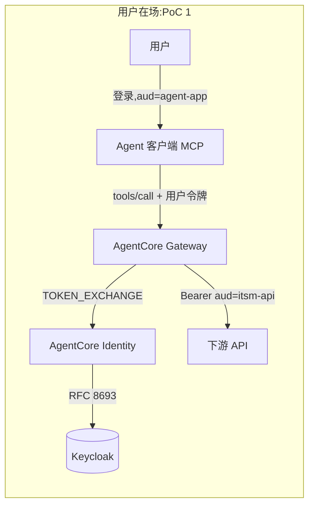
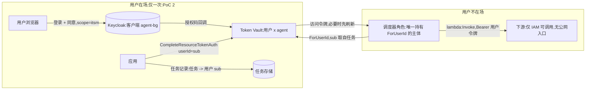

# AgentCore 委托授权 PoC

[English](README.md) | 简体中文

在 Amazon Bedrock AgentCore 上,让 agent 代替用户行动的两个概念验证:

1. **用户在场:OBO 令牌交换。** agent 经 AgentCore Gateway 调用下游 API,网关在每次请求时把用户令牌换成下游令牌,下游看到的是真实用户。
2. **用户不在场:3LO + Token Vault。** 用户同意一次,之后由调度器在没有用户会话的情况下,从 AgentCore Identity 的 Token Vault 取出该用户的令牌,硬过期时间由身份提供商控制。

第二个 PoC 模拟的是工作区类平台里常见的一种模式:每用户一个认证锚点、把会话转发给各个工作区、再由服务端保管一份刷新凭据,让无人值守的自动任务在硬过期之前可以运行。本仓库把这套模式映射到 AgentCore,并测出它哪里成立、哪里有缺口。

状态:私有、实验性质,不是生产代码。

## 架构





| 模式中的组件 | AgentCore 对应 | 本仓库是否实现 |
|---|---|---|
| 每用户认证锚点 | 身份提供商会话 + AgentCore 工作负载身份 | 是 |
| 把会话转发给工作区(用户在场) | Gateway 每次请求做 OBO 交换 | 是(PoC 1) |
| 服务端保管的刷新凭据 | Token Vault,3LO 授权码流程 | 是(PoC 2) |
| 硬过期,到期由用户重新同意 | 身份提供商的刷新令牌 / 会话有效期 | 是(PoC 2) |
| 限制谁能使用这份凭据 | IAM:只有调度器角色拥有 `ForUserId`,其他主体显式拒绝 | 是(PoC 2) |
| 工作区(计算环境) | AgentCore Runtime 会话(每个会话一个 microVM) | **否** |

## 目录

```
poc/          kc_check.py   手工做 Keycloak 令牌交换,并直接检查下游
              e2e.py        PoC 1:以 alice 和 bob 的身份经网关做 MCP 调用
              bg3lo.py      PoC 2:setup / run / later(3LO 同意、调度器取令牌、过期)
              bg_test.py    OBO 网关上"没有用户令牌"的场景(E1–E4)
              cdp_login.mjs 用 Chrome(CDP)完成 PoC 2 的登录与同意页
downstream/   index.mjs     模拟 ITSM API(Lambda):校验 JWT 的 iss / exp / aud / 签名,只返回调用者自己的数据
scripts/      keycloak-setup.sh、cleanup.sh
docs/         setup.md(搭建)、results.md(结果)
```

## 运行

前提:开通了 AgentCore 的 AWS 账号、AWS CLI v2、Python 3、Node 22+、一个可通过 HTTPS 访问的 Keycloak 26.2 及以上版本(不能是 `localhost`,AgentCore 要能访问 discovery 地址)、以及用 `--remote-debugging-port=9222` 启动的 Chrome(用于同意页这一步)。

```bash
cp .env.example .env && $EDITOR .env && set -a && . ./.env && set +a
# 按 docs/setup.md 创建 Keycloak 客户端、OAuth2 凭据提供者、
# 网关和目标、工作负载身份以及 IAM 角色
python3 poc/e2e.py                 # PoC 1
python3 poc/bg3lo.py setup         # PoC 2:alice 在浏览器里同意
python3 poc/bg3lo.py run           # 调度器取她的令牌,并跑反向测试
python3 poc/bg3lo.py later         # 分别在访问令牌过期后、会话上限之后再运行
```

## 发现(详见 `docs/results.md`)

- 用户在场时 OBO 成立:下游看到的 `sub` 不变,`aud` 被改写,每个用户只拿到自己的数据。agent 客户端从不持有下游凭据。
- Keycloak 的标准令牌交换不写 `act` 声明,下游只能通过 `azp` 判断这是 agent 的调用。要写入 `act` 需要 Keycloak 的预览功能"委托",它要求每个会话都由用户同意,不适合无人值守的场景。
- 没有用户令牌时,如果不限制 `allowedClients`,网关会接受 agent 自己的 client-credentials 令牌。
- Token Vault 能做到"同意一次,稍后运行":在身份提供商的会话上限之内会静默刷新;超过上限后,Vault 不再返回令牌,而是返回新的授权链接。
- `GetWorkloadAccessTokenForUserId` 接受的是未经验证的用户 ID 字符串。谁持有这个 IAM 权限,谁就能取出任何已经同意过的用户的令牌。这个权限的授予范围就是爆炸半径。
- CloudTrail 会记录 `ForUserId` 的调用,但不记录传入的用户 ID。应用必须自己记录"任务、用户、时间"。

## 安全说明

- 密钥文件(`secrets.env`、`.env`)已加入 `.gitignore`。测试用户为了方便使用了密码模式,生产环境不要这样做。
- 模拟下游没有公网入口,并自己校验令牌。Keycloak 以 `start-dev` 模式运行,前面有一层屏蔽管理路径的 CDN。这两者都只是测试脚手架。
- 用完后请阅读并运行 `scripts/cleanup.sh`。测试资源会持续运行并产生费用。
