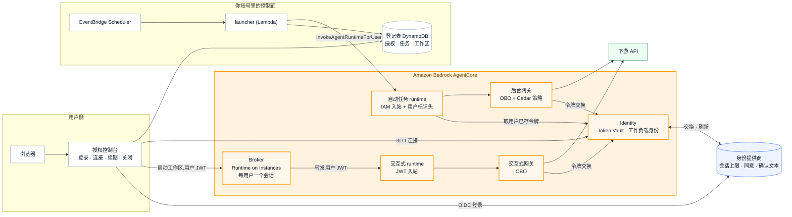
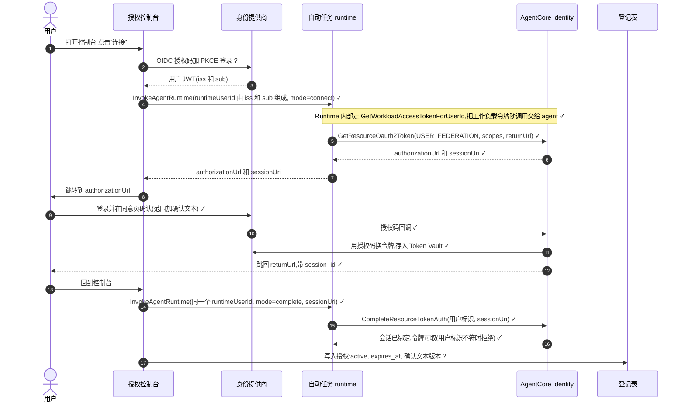
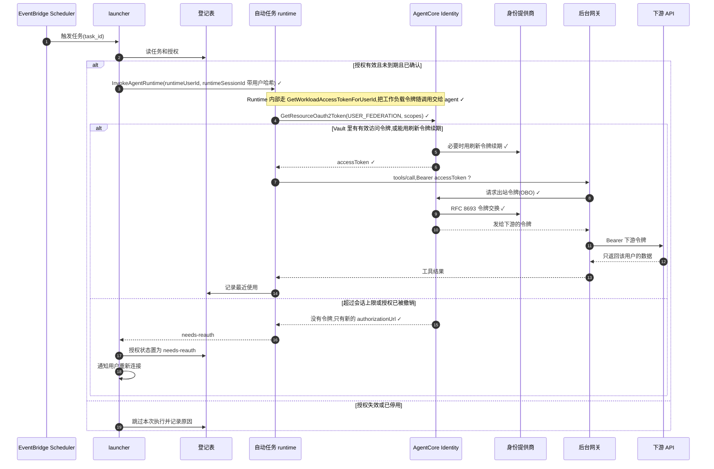
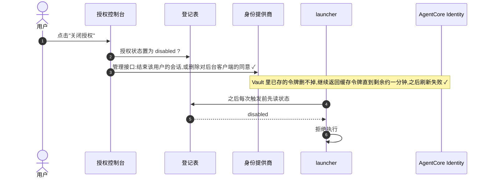

# 架构设计 v1:在 AgentCore 上复刻"认证锚点、长期授权、自动任务"模式

本文是**目标设计**,还没有实现。仓库里已有的是 v0(OBO 加 3LO 的两个 PoC),见 `docs/results.md`。本文回答两件事:每个设计点是什么,以及**为什么这样设计**。

设计目标:尽可能与参考系统的行为一致,不为了省事而简化。做不到一致的地方,逐条记为"等价替代""偏差"或"无法对应",并写明原因。

原因标签:**参考系统**=要保留的性质;**AWS 约束**=查文档确认的平台限制;**实测**=v0 里测到的结果;**规范**=标准文档的要求;**最佳实践**=Well-Architected、零信任等做法;**取舍**=有意识的权衡;**方法**=度量方法上的考虑。

保真度:**一致**=机制和性质都对得上;**等价替代**=机制不同、性质相同;**偏差**=有意识地做得不同;**无法对应**=AWS 上没有对应物;**刻意增强**=超出参考系统的改进,可以关掉。

## 1. 设计原则与原因

1. **复刻性质,不复刻机制。** 参考系统的机制(终端登录、会话转发通道、凭据文件)属于它自己的运行环境,搬到 AWS 上要保留的是性质:每人一个锚点、凭据在服务端、不落盘、硬过期、只在受管环境使用、默认不提示。机制不同的地方,以 AgentCore 的现成能力为准,并在文档里标出"等价替代"。
2. **在使用的那一刻授权。** OBO 只保护一次调用发生的那一刻,离线调用又没有现成的用户令牌。所以凭据留在服务端、访问令牌短期有效、下游每次自己校验,让授权发生在使用时,而不是取回时。
3. **默认拒绝。** 后台任务没有人盯着。授权失效、任务没被选中、用户标识来源不明,都应当停下并让用户看见,而不是重试,也不能降级到更宽的凭据。
4. **优先用平台强制的约束。** 入站认证二选一、会话固定、托管身份不能导出令牌,这些是平台强制的,不依赖我们的代码写对。我们自己写的检查会漏、会过时。
5. **对标与增强分开。** 要回答的问题是"这套模式在 AWS 上能做到什么程度"。增强项(区分后台与本人、工具级策略)单独成档,和严格对标的结果分开度量。

## 2. 目标架构

| 组件 | 作用 | 参考系统中的对应物 |
|---|---|---|
| 授权控制台 | 登录、连接、续期、关闭、查看列表 | 用户的设置页面 |
| Broker(Runtime on Instances) | 每用户一个锚点,发放并登记会话 | 每用户认证锚点 |
| 交互式 runtime | 承载用户在场的工作区,JWT 入站 | 使用用户会话的工作区 |
| 自动任务 runtime | 承载用户不在场的工作区,IAM 入站加用户标识头 | 使用长期授权的工作区 |
| 交互式网关 / 后台网关 | 入站校验、工具策略、出站令牌交换 | (参考系统没有) |
| Identity:Token Vault、工作负载身份、凭据提供者 | 保存长期授权,按用户和 agent 隔离 | 长期授权的服务端存放 |
| 身份提供商(PoC 用 Keycloak) | 登录、同意、会话上限 | 企业认证系统 |
| EventBridge Scheduler + launcher | 触发自动任务,先查授权再调用 | 自动任务 |
| 登记表(DynamoDB) | 授权、任务、工作区、确认文本版本 | 设置页与列表里的状态 |
| 下游 API(Lambda) | 自己校验令牌,按用户返回数据 | 被访问的内部系统 |

## 3. 授权的 API 调用图

三张时序图覆盖授权的整个生命周期:授予(用户在场,一次)、使用(用户不在场)、关闭。

图例:**✓** 表示在 v0 或 v1 里观察到过;**?** 表示设计如此,还没有验证。授予和使用都经过自动任务 runtime,走用户标识路径(V1 实测:它和用户 JWT 路径的 Vault 条目不通用)。时序图里没有 ✓ 的步骤,是设计里有、v0 和 v1 都还没测的部分。

### 3.1 授予授权(用户在场,一次)

### 3.2 使用授权(用户不在场)

### 3.3 关闭授权

### 3.4 调用清单

| 调用 | 谁调用 | 作用 | 需要的权限或凭据 | 状态 |
|---|---|---|---|---|
| `GetWorkloadAccessTokenForUserId` | 没有主体直接调用,Runtime 在内部调用(授予和使用都是) | 为用户标识路径生成工作负载令牌 | 对所有主体显式拒绝。对托管的工作负载身份,调用方直接调用会被平台拒绝 | 已验证:Runtime 内部调用成立,直接调用被拒;v0 里由调度器直接调用(自管的工作负载身份) |
| `GetWorkloadAccessTokenForJWT` | 交互式网关(网关服务角色) | 用户在场时,为 OBO 生成"用户 × agent"的工作负载令牌 | 同名 IAM 动作,限定到网关的工作负载身份 | v0 已验证(PoC 1)。它的 Vault 条目与用户标识路径不通用(V1) |
| `GetResourceOauth2Token`(`USER_FEDERATION`) | 授权控制台后端(授予时);自动任务 runtime 里的 agent(使用时) | 取用户令牌;没有时返回授权链接和 sessionUri | 同名 IAM 动作,限定到工作负载身份和那一个凭据提供者;读取该提供者客户端密钥的 Secrets Manager 权限(v0 里需要) | v0 已验证(用户标识路径) |
| `CompleteResourceTokenAuth` | 自动任务 runtime 里的 agent(控制台以 complete 模式请求) | 把授权会话和用户绑定,之后令牌才可取 | 同名 IAM 动作,在 Runtime 执行角色上,限定到工作负载身份 | 已验证:用户标识不符时返回 `Invalid or expired session` |
| `InvokeAgentRuntime`(带 `runtimeUserId`) | launcher(使用);授权控制台后端(connect 和 complete) | 以指定用户身份调用自动任务 runtime | `InvokeAgentRuntime` 和 `InvokeAgentRuntimeForUser`,限定到自动任务 runtime 的 ARN 和 `runtime-endpoint/*`。只给前者时带 `runtimeUserId` 的调用被拒 | 已验证 |
| `tools/call`(MCP) | 自动任务 runtime 里的 agent | 经后台网关调用下游 | 入站令牌来自 Vault,网关校验 `azp` 并套用 Cedar 策略 | 设计,V6 |
| 令牌交换(RFC 8693) | AgentCore Identity,代表网关 | 换发只给下游的令牌 | 后台交换客户端的凭据保存在凭据提供者里 | v0 已验证(交互式路径) |
| 撤销授权 | 授权控制台后端 | 关闭授权 | 身份提供商的管理接口(结束用户会话,或删除用户对后台客户端的同意) | 已验证,两种都有效;影响见 V7 |

## 4. 设计点总览

| 编号 | 设计点 | 保真度 | 状态 | 一句话原因 |
|---|---|---|---|---|
| A1 | 每用户一个认证锚点(broker) | 一致、等价替代 | 设计,未实现、待验证 | 只有 Instances 的会话能活到 14 天,且必须自己绑定用户与会话 |
| A2 | 用户在浏览器里完成交互式登录(授权控制台) | 等价替代 | 已实现(v0)、设计,未实现 | 认证强度由认证系统决定;RFC 9700 要求授权码加 PKCE |
| A3 | 会话转发:由 Runtime 把工作负载令牌交给 agent | 等价替代、无法对应 | 设计,未实现 | 令牌按调用取、不落盘;凭据文件是降级路径,不复刻 |
| A4 | 按风险分级的会话时长 | 等价替代 | 设计,未实现、待验证 | 高风险用户的暴露窗口更小;Keycloak 只能近似 |
| A5 | 工作区存活时间短于锚点 | 偏差 | 设计,未实现 | 用 8 小时上限换会话固定 |
| A6 | 过期后重新认证:停止并提示,不重试 | 一致 | 已实现(v0)、设计,未实现 | 授权失效时默认拒绝并让用户可见 |
| B1 | 长期授权:3LO 授权保存在 Token Vault,硬过期由身份提供商强制 | 一致 | 已实现(v0)、待验证 | 硬过期必须由签发方强制;Vault 按用户和 agent 隔离 |
| B2 | 同意时的确认:范围同意加版本化确认文本 | 等价替代 | 已实现(v0)、设计,未实现、待验证 | 责任归属必须明确且可追溯 |
| B3 | 授权的创建位置限制:PoC 不模拟 | 无法对应 | — | Keycloak 没有现成能力,硬写会得到假控制 |
| B4 | 自助管理:授权控制台加登记表 | 等价替代、偏差 | 设计,未实现、待验证 | 用户必须能看见并撤回授权;AgentCore 没有按用户删令牌的接口 |
| C1 | 按任务选择是否使用授权 | 一致 | 设计,未实现 | 默认拒绝:没被明确选中的任务不使用授权 |
| C2 | 两种会话类型由两个 runtime 承载,互不混用 | 一致 | 设计,未实现 | 入站认证二选一加会话固定,平台天然防混用 |
| C3 | 工作区列表 | 等价替代 | 设计,未实现 | 看得见,才能发现不该存在的授权 |
| D1 | 自动任务:launcher 经 Runtime 以用户身份启动 | 一致 | 已实现(v0)、设计,未实现、待验证 | 控制点从"取令牌的权限"收窄为"以某用户调用某 runtime 的权限" |
| D2 | 使用范围:只有 launcher 能以用户身份调用,其余全部显式拒绝 | 一致、刻意增强 | 已实现(v0)、设计,未实现、待验证 | 平台不核对用户标识,安全完全靠 IAM 范围 |
| G1 | 两个网关:交互式与后台各一个 | 刻意增强 | 已实现(v0)、已验证(v1) | 入站校验、策略、凭据提供者都是网关级配置 |
| G2 | 下游自己校验令牌,不暴露为公开函数 | — | 已实现(v0) | 不因网络位置信任调用方;公开函数 URL 会被治理移除 |
| G3 | 为什么要自建 Runtime 里的代码:托管组件的核对 | — | 已核对文档(未实测) | 按用户的出站授权在托管组件里都依赖入站 JWT,无人值守时没有 JWT |
| E1 | 操作记在用户名下 | 一致 | 已实现(v0) | 责任归属明确,授权决定在资源一侧 |
| E2 | 让下游分得清后台与本人(刻意增强) | 刻意增强 | 已验证(v1) | Keycloak 不写 act,只能靠 azp;增强与对标分开度量 |
| E3 | 审计由多处记录拼接 | 刻意增强 | 已实现(v0)、设计,未实现 | 任何单一日志源都还原不了委托链 |

## 5. 设计点详述

### A. 认证锚点与登录

#### A1 · 每用户一个认证锚点(broker)

保真度:**一致、等价替代**  ·  状态:设计,未实现、待验证  ·  待验证:V5

- **参考系统的性质:** 每个用户有一个认证锚点:首次访问时创建,连续运行数天,是该用户所有会话的发放中心,自己持有已认证的会话,只有本人能连接。
- **AgentCore 上的设计:** 在 AgentCore Runtime 的 Instances 计算类型(容量提供者)上放一个 broker agent,每个用户一个会话。`runtimeSessionId` 由 `iss` 和 `sub` 派生,`maxLifetime` 和 `idleRuntimeSessionTimeout` 都设为 7 天。控制台后端先校验用户 JWT,再调用 broker。broker 只保存登记信息,不保存任何令牌。轻量档:用无状态的 Lambda 加登记表代替,保留除"持续运行"以外的性质。
- **原因:**
  - **参考系统**:锚点的价值是"每人一个、持续数天、只有本人能连"。
  - **AWS 约束**:microVM 会话最长 8 小时,只有 Instances 的会话能到 14 天,所以字面复刻"这台机器连续运行数天"只能用 Instances。这只决定锚点能不能常驻,与授权时长无关:授权在 Vault、身份提供商的会话上限和登记表里,锚点停掉不会丢授权,下次调用再起一个会话即可。
  - **AWS 约束**:Instances 不提供会话固定,平台不会替你把用户和会话绑起来,文档要求后端自己维护这个映射。所以 `runtimeSessionId` 由已验证的 JWT 派生,不接受客户端传入。
  - **AWS 约束**:空闲超时默认只有 15 分钟,到点后计算会被终止(持久卷保留,下次调用用同一个会话 ID 再起新实例)。想让 broker 真正连续运行数天,必须把空闲超时也调大,代价是整段时间持续计费;不调大就是"随用随起",体验上少了"一直开着"。
  - **取舍**:保真度里的"等价替代"指的是这一条:参考系统的锚点自己持有已认证的会话并转发给其他工作区,这里不复刻"持有会话"。其余性质(每人一个、常驻、发放会话、只有本人能连)一致。
  - **最佳实践**:长期运行的机器不持有长期凭据:令牌留在 Vault,broker 里只有登记信息,避免它成为高价值目标。
  - **取舍**:每个用户一台托管 EC2,费用和运维都高于 microVM,所以保留轻量档,并把 Instances 限制在测试期间运行。

**锚点的定义:** 每个用户一个、首次访问时创建、持续运行数天、所有会话都从它发放、只有本人能连接的常驻入口。它不是授权本身,授权存放在 Token Vault、身份提供商的会话上限和登记表里。

| 锚点的属性 | 对应的资源和 feature | 状态 |
|---|---|---|
| 每个用户一个 | 一个 Runtime 会话。`runtimeSessionId` 由已验证 JWT 的 `iss` 和 `sub` 派生。Instances 没有会话固定,用户到会话的映射由后端维护 | 设计 |
| 首次访问时创建 | 控制台后端第一次收到该用户的已验证 JWT 时,用新会话 ID 调用 broker runtime,并在登记表(DynamoDB)写一行 | 设计 |
| 连续运行数天 | Runtime 的 Instances 计算类型加容量提供者(`CreateCapacityProvider`、`capacityProviderConfiguration`)。`maxLifetime` 和 `idleRuntimeSessionTimeout` 都设为 7 天。microVM 上限 8 小时,Instances 上限 14 天 | 设计。CLI 里有这些接口,目标区域是否可用、价格、配额未查(V5) |
| 发放该用户所有会话 | broker agent 读登记表,带用户 JWT 调用交互式 runtime(JWT 入站,microVM V2 有会话固定)。自动任务由 launcher 直接调用自动任务 runtime,不经过 broker | 设计 |
| 只有本人能连 | 控制台后端校验 OIDC JWT。IAM 只允许后端角色调用 broker runtime。会话 ID 不接受客户端传入 | 设计 |
| 不持有长期凭据 | Token Vault 保存令牌,身份提供商的会话上限决定硬过期,登记表保存状态。broker 只读登记表 | Vault 和会话上限在 v0 已验证,其余是设计 |

#### A2 · 用户在浏览器里完成交互式登录(授权控制台)

保真度:**等价替代**  ·  状态:已实现(v0)、设计,未实现

- **参考系统的性质:** 认证由用户本人在浏览器里完成,凭据由用户输入,平台只是代为发起。
- **AgentCore 上的设计:** 授权控制台用 OIDC 授权码流程加 PKCE 让用户在浏览器里登录身份提供商。口令校验、多因素和设备策略都留在身份提供商。v0 里这一步只是用脚本驱动 Chrome 模拟。
- **原因:**
  - **参考系统**:认证强度由认证系统决定,不由 agent 或工作区决定。
  - **规范**:OAuth 2.0 安全最佳实践(RFC 9700)要求授权码加 PKCE,不用密码模式。v0 为了取令牌方便用了密码模式,只用于测试,设计里不保留。
  - **实测**:v0 证明浏览器里的登录和同意流程能跑通,但脚本不是产品形态,所以设计里需要一个真正的页面。

#### A3 · 会话转发:由 Runtime 把工作负载令牌交给 agent

保真度:**等价替代、无法对应**  ·  状态:设计,未实现

- **参考系统的性质:** 锚点把用户的会话转发给各个工作区;凭据由托管的客户端套件提供,默认不写成文件;老工具需要文件时才按需生成。
- **AgentCore 上的设计:** broker 带着用户 JWT 调用交互式 runtime。Runtime 校验签发方和受众后,随调用把工作负载访问令牌(用户加 agent)交给 agent。agent 在调用下游时才用 `GetResourceOauth2Token` 取令牌,不写磁盘、不放环境变量。不复刻"按需生成凭据文件":需要长期令牌文件的老下游不在范围内。
- **原因:**
  - **参考系统**:会话转发的目的,是每个工作区不用各自认证,又不留下可拷走的凭据。
  - **AWS 约束**:托管的工作负载身份不能直接取令牌,文档说明这是为了防止 agent 导出令牌;Runtime 自动交付令牌符合这个模型。
  - **最佳实践**:Well-Architected 的 AGENTSEC03-BP03 要求临时凭据;按调用取令牌,让令牌的生命周期短到只覆盖一次调用。
  - **取舍**:凭据文件是为兼容老工具保留的降级路径。复刻它等于把长期令牌落盘,所以明确不做。

#### A4 · 按风险分级的会话时长

保真度:**等价替代**  ·  状态:设计,未实现、待验证  ·  待验证:V4

- **参考系统的性质:** 会话时长按用户风险分级,高风险组更短。
- **AgentCore 上的设计:** 两套身份提供商会话策略(SSO 会话上限),登录时按用户所在组选择。Keycloak 没有按组设置会话上限的原生功能,用两个客户端近似,由控制台按组选择。
- **原因:**
  - **参考系统**:高风险用户的凭据暴露窗口更小。
  - **最佳实践**:最小化凭据有效期是最小权限的一部分(AGENTSEC03-BP03)。
  - **取舍**:Keycloak 做不到原生的按组会话上限,所以这一项是近似,不是等价,文档里如实标注。

#### A5 · 工作区存活时间短于锚点

保真度:**偏差**  ·  状态:设计,未实现

- **参考系统的性质:** 工作区只存活数小时,锚点的存活时间更长。
- **AgentCore 上的设计:** 交互式 runtime 默认用 microVM 会话,`maxLifetime` 取平台上限 8 小时,到期后会话可在新计算上恢复,会话存储保留。若要字面对齐参考系统的工作区时长,把交互式 runtime 放到 Instances 上(上限 14 天)。
- **原因:**
  - **AWS 约束**:microVM 的 `maxLifetime` 上限是 28800 秒,超过会创建失败;Instances 上限 14 天。
  - **取舍**:默认选 microVM,是因为只有它(平台版本 V2)支持会话固定:一个会话只能由创建它的用户、用同一种认证方式继续访问。这个性质比字面的工作区时长重要,所以接受与参考系统的偏差,并记为偏差。

#### A6 · 过期后重新认证:停止并提示,不重试

保真度:**一致**  ·  状态:已实现(v0)、设计,未实现

- **参考系统的性质:** 会话过期后,下一次访问时提示用户重新认证;锚点已在运行,所以不用等冷启动。
- **AgentCore 上的设计:** `GetResourceOauth2Token` 返回授权链接而不是令牌时,登记表把授权标为 `needs-reauth`。launcher 跳过该任务并通知用户,控制台显示连接按钮。
- **原因:**
  - **实测**:v0 里超过身份提供商会话上限后,Vault 不再返回令牌,而是返回新的授权链接,不会悄悄沿用旧凭据。
  - **最佳实践**:授权失效时默认拒绝并让用户可见,而不是重试或降级到更宽的凭据(零信任:每次访问都重新评估)。
  - **参考系统**:重新认证是一次点击,不是一次重建。broker 已在运行,所以体验与参考系统一致。

### B. 长期授权

#### B1 · 长期授权:3LO 授权保存在 Token Vault,硬过期由身份提供商强制

保真度:**一致**  ·  状态:已实现(v0)、待验证  ·  待验证:V4

- **参考系统的性质:** 一份绑定用户身份的刷新凭据保存在服务端,不进入任何工作区,固定天数后失效。
- **AgentCore 上的设计:** 为后台 OAuth 客户端做一次 3LO 授权,令牌保存在 Token Vault 的(用户 × 工作负载身份)下。agent 只拿到短期访问令牌,刷新令牌留在 Vault。7 天上限由身份提供商的离线会话或客户端会话上限强制。v0 用 300 秒上限验证了硬停止。
- **原因:**
  - **参考系统**:这是整套模式的核心:凭据在服务端,工作区拿不到,到期必须本人重来。
  - **AWS 约束**:Vault 按用户和 agent 保存令牌并用 KMS 加密,一个 agent 取不到另一个用户的令牌,正好对应"凭据在服务端"。
  - **实测**:v0 里 Vault 遵守身份提供商的会话上限:上限之内静默刷新,超过后不再返回令牌。
  - **最佳实践**:硬过期必须由签发方强制。放在应用里的过期时间可以被绕过;文档里没有看到 Vault 一侧的到期设置,所以不依赖它。

#### B2 · 同意时的确认:范围同意加版本化确认文本

保真度:**等价替代**  ·  状态:已实现(v0)、设计,未实现、待验证  ·  待验证:V4

- **参考系统的性质:** 创建授权要明确确认:在授权有效期内,这份凭据就是用户本人,用它做的任何事都记在用户名下。
- **AgentCore 上的设计:** 身份提供商同意页列出请求的范围(v0 已验证只显示 `itsm`)。再加一个条款确认的必需动作,带上确认文本和版本,登记表随授权一起保存。
- **原因:**
  - **参考系统**:参考系统不区分 agent 和本人,用责任声明弥补这一点,所以同意必须是明确的。
  - **最佳实践**:授权要具体、最小且可追溯:只列任务需要的范围,确认文本带版本,事后能证明用户当时同意的是什么。
  - **取舍**:身份提供商的条款确认动作能否定制文本并记录版本,还没验证(V4)。

#### B3 · 授权的创建位置限制:PoC 不模拟

保真度:**无法对应**  ·  状态:—

- **参考系统的性质:** 只允许在受认可的浏览器里创建或续期授权。
- **AgentCore 上的设计:** PoC 不实现。生产环境由身份提供商的条件访问或设备信任策略,对授权客户端强制。
- **原因:**
  - **取舍**:Keycloak 里没有对应的现成能力。硬写一个自定义检查,会得到一个看起来有效、实际不可靠的假控制,比没有更糟。
  - **最佳实践**:设备和位置策略应该在身份提供商里统一管理,不应分散在各个应用里。

#### B4 · 自助管理:授权控制台加登记表

保真度:**等价替代、偏差**  ·  状态:设计,未实现、待验证  ·  待验证:V7

- **参考系统的性质:** 用户能查看授权状态和到期时间、续期、关闭。
- **AgentCore 上的设计:** 控制台读写授权登记表(DynamoDB):状态、到期时间、最近使用、确认文本版本。续期重复 3LO 流程。关闭时登记表置为停用(launcher 之后拒绝执行),并在身份提供商撤销。访问令牌设为 120 秒,把撤销之后的可用窗口压小;不能再短,因为网关入站会拒绝剩余不足约一分钟的令牌。
- **原因:**
  - **最佳实践**:用户能看见并撤回自己的授权,是委托授权可审计的前提。
  - **AWS 约束**:AgentCore 的服务模型里没有"列出某用户授权"或"删除某用户令牌"的接口(只能删除整个凭据提供者),所以登记表必须由应用自己维护。
  - **取舍**:因为不能主动删除 Vault 里的令牌,撤销靠"身份提供商撤销、登记表停用、launcher 拒绝"。Vault 里已有令牌的可用时间取决于访问令牌寿命,所以要设得尽量短。实测(V7):撤销后 Vault 继续返回缓存的令牌,直到它剩余约一分钟,然后刷新失败、返回需要重新授权。网关要求剩余有效期大于约一分钟,令牌寿命最短取 120 秒,所以撤销后经 Vault 取到令牌的窗口最多约一分钟;已经发给下游的令牌在 `exp`(最多 120 秒)之前仍有效。

### C. 模式与会话类型

#### C1 · 按任务选择是否使用授权

保真度:**一致**  ·  状态:设计,未实现

- **参考系统的性质:** 每个工作区、每个自动任务都能选择是否使用长期授权。
- **AgentCore 上的设计:** 任务和工作区记录里的 `credentialMode`:`grant` 或 `interactive`。launcher 只执行 `grant` 的任务。
- **原因:**
  - **最佳实践**:默认拒绝:没有被明确选中的任务,不会用到任何长期授权。
  - **参考系统**:授权的使用范围要细到单个任务,而不是整个账号。

#### C2 · 两种会话类型由两个 runtime 承载,互不混用

保真度:**一致**  ·  状态:设计,未实现

- **参考系统的性质:** 一个工作区只使用一种会话,切换不可逆。
- **AgentCore 上的设计:** 交互式 runtime 用 JWT 入站认证,自动任务 runtime 用 IAM 入站认证并带用户标识头。microVM 的 V2 平台版本会把会话固定到创建它的用户身份,并要求后续调用使用同一种认证方式。要换种类就开新会话。登记表只允许同一任务从 `grant` 降到 `interactive`,不允许反向。
- **原因:**
  - **AWS 约束**:一个 Runtime 的入站认证只能是 JWT 或 IAM 二选一(文档明确)。所以"两种会话类型"在平台层天然分开。
  - **AWS 约束**:会话固定要求同一用户、同一认证方式,一个会话不会出现两种身份来源。
  - **最佳实践**:"用户在场"与"用户不在场"的风险画像不同。混在同一个会话里,下游和审计都无法区分。优先用平台强制的约束,不要自己写一套防混用逻辑。

#### C3 · 工作区列表

保真度:**等价替代**  ·  状态:设计,未实现

- **参考系统的性质:** 列表显示每个工作区用哪种会话,以及剩余时间。
- **AgentCore 上的设计:** `spaces list`:基于登记表显示会话类型、到期时间、最近活动。
- **原因:**
  - **最佳实践**:能看到"哪些会话在用哪种凭据、还剩多久",运维才能发现不该存在的授权(Well-Architected 要求持续审计 agent 权限)。
  - **取舍**:要展示的是应用层信息(任务、会话类型、授权状态),平台并不知道,所以从登记表读取。

### D. 自动任务

#### D1 · 自动任务:launcher 经 Runtime 以用户身份启动

保真度:**一致**  ·  状态:已实现(v0)、设计,未实现、待验证  ·  待验证:V2、V3

- **参考系统的性质:** 自动任务在用户不在场时启动工作区,用长期授权认证,不再提示。
- **AgentCore 上的设计:** EventBridge Scheduler 触发 launcher(Lambda)。launcher 先查登记表:授权有效、未到期、已确认。通过后对自动任务 runtime 调用 `InvokeAgentRuntime`,`runtimeUserId` 取自任务记录。Runtime 内部用用户标识路径取得工作负载令牌,agent 再从 Vault 取用户的令牌。不通过则标为 `needs-reauth`,不执行。`runtimeSessionId` 里带用户标识的哈希,并在登记表写一条运行记录。
- **原因:**
  - **实测**:v0 里调度器角色直接调 `GetWorkloadAccessTokenForUserId`,CloudTrail 只记录调用方和工作负载名,不记录用户 ID,事后查不出替谁取过令牌。
  - **AWS 约束**:经 Runtime 调用时,文档要求额外的 IAM 动作 `InvokeAgentRuntimeForUser`,并建议用 CloudTrail 监控带 `runtimeUserId` 的 `InvokeAgentRuntime`。实测:数据事件里没有 `runtimeUserId`(见 V3)。Runtime 会随调用把工作负载令牌交给 agent,agent 用它向 Vault 要用户的令牌(实测成立);托管的工作负载身份不能被调用方取令牌,实测返回"linked to a service"错误,文档说明这是为了防止 agent 导出令牌。
  - **实测**:P1 已跑通:EventBridge Scheduler 触发 launcher,launcher 经 Runtime 读 Vault 并调用下游,返回 200;授权过期、从未授权、已关闭三种情况都不会调用下游。
  - **最佳实践**:控制点从"能取任何已授权用户令牌的权限",收窄为"能以指定用户身份调用这一个 runtime 的权限",范围更小。
  - **AWS 约束**:用户标识必须来自已认证的来源,而不是调用方自带的值(文档明确要求),所以取自用户在场时写下的任务记录。

#### D2 · 使用范围:只有 launcher 能以用户身份调用,其余全部显式拒绝

保真度:**一致、刻意增强**  ·  状态:已实现(v0)、设计,未实现、待验证  ·  待验证:V2

- **参考系统的性质:** 长期授权只能在受管环境里使用,其他环境只能创建、不能使用。
- **AgentCore 上的设计:** IAM:只有 launcher 角色拥有 `InvokeAgentRuntimeForUser`,并限定到自动任务 runtime 的 ARN;其他主体(包括人的角色)显式拒绝。授予授权必须走用户标识路径(V1 实测),而托管的工作负载身份不能被调用方取令牌(V2 实测),所以授予也在 Runtime 里完成:授权控制台后端在校验用户 JWT 之后,带 `runtimeUserId`(由 `iss` 和 `sub` 组成)调用同一个 Runtime 的 `connect` 和 `complete` 模式。控制台角色因此和 launcher 一样需要 `InvokeAgentRuntime` 与 `InvokeAgentRuntimeForUser`。`GetWorkloadAccessTokenForUserId` 对所有主体显式拒绝。生产环境再加组织级 SCP。
- **原因:**
  - **AWS 约束**:平台不会核对用户标识是否真属于调用者,安全完全依赖 IAM 范围(文档明确)。托管策略 `BedrockAgentCoreFullAccess` 默认就包含这个权限。
  - **实测**:v0 里不得不把 `ForUserId` 授予无人值守的调度器,这是整个方案最大的单点。v1 里没有主体需要它:授予和使用都经过 Runtime。实测带 `runtimeUserId` 的调用必须同时有 `InvokeAgentRuntime` 和 `InvokeAgentRuntimeForUser`,只给前者会被拒绝。
  - **取舍**:单点换了位置。控制台角色和 launcher 角色都能"以任意用户标识调用这个 Runtime",而且授予、使用共用一个 Runtime(Vault 条目按工作负载身份分开),IAM 区分不了调用的是哪种模式,模式只能靠 agent 代码限制。只有 agent 代码固定的几种动作可以被触发,令牌不会返回给调用方。
  - **实测**:会话绑定会核对用户:拿一个用户的授权会话、用另一个用户的标识调用 `CompleteResourceTokenAuth`,返回 `Invalid or expired session`。所以调用方在请求体里写错或伪造用户标识,不能把别人的同意绑到自己名下。
  - **最佳实践**:把 agent 与人的权限分开(AGENTSEC03-BP02),显式拒绝优先于允许;组织级 SCP 是账号内策略失误时的兜底。PoC 账号没有组织控制,所以 SCP 只作为生产要求列出。
  - **参考系统**:对应"授权只能在受管环境里使用"。

### G. AgentCore 上需要额外决定的部分

#### G1 · 两个网关:交互式与后台各一个

保真度:**刻意增强**  ·  状态:已实现(v0)、已验证(v1)

- **参考系统的性质:** 参考系统没有这一层;这是在 AgentCore 上必须额外决定的部分。
- **AgentCore 上的设计:** 交互式网关:入站校验用户令牌(受众为 agent 应用),目标用 OBO 令牌交换。后台网关:入站校验受众,并用自定义声明规则要求令牌的 `azp` 是后台客户端;目标用独立的凭据提供者和独立的交换客户端;挂 Cedar 策略,只允许读类工具,其余默认拒绝。
- **原因:**
  - **AWS 约束**:入站校验、策略引擎和出站凭据提供者都是网关级配置。分成两个网关,可以独立配置、独立测试,出错时影响面也分开。
  - **实测**:v0 里交换后令牌的 `azp` 是发起交换的客户端。后台用独立的交换客户端,下游才能靠 `azp` 区分后台调用。
  - **最佳实践**:Cedar 策略在网关边界强制工具范围,不受 LLM 推理影响(AGENTREL02-BP02)。
  - **实测**:后台网关已跑通:从 Vault 取到的令牌(`azp=agent-bg`)通过入站校验,经 `agent-bg-ex` 做 OBO 交换,下游看到 `azp=agent-bg-ex`,没有 `act`。另一个客户端的令牌(受众正确、`azp` 不同)被 `azp` 规则拒绝,去掉规则后同一个令牌能通过。
  - **实测**:Cedar 在 ENFORCE 下只允许 `listMyIncidents`:`tools/list` 里看不到 `approveIncident`,调用它返回 `Tool Execution Denied ... denied by default`。LOG_ONLY 下两个工具都能调用。
  - **AWS 约束**:网关入站会拒绝剩余有效期不足约一分钟的令牌,所以后台客户端的访问令牌寿命必须大于一分钟(PoC 用 120 秒)。Vault 在令牌剩余约一分钟时刷新,两个阈值对得上,150 秒连续调用没有失败。靠近身份提供商会话上限的最后一分钟,令牌寿命被会话截短,也会被拒,所以登记表的 `expires_at` 要比身份提供商的上限早一分钟以上。
  - **AWS 约束**:Cedar 策略只写 permit:被跳过的 forbid 不会拦截任何请求。策略里的动作名只有 `<目标>___<操作>` 这一种,`tools/list` 和 `initialize` 不能写进去。网关自己的角色需要 `GetPolicyEngine`、`AuthorizeAction`、`PartiallyAuthorizeActions`,缺了会在挂载时报错。
  - **取舍**:也可以用一个网关加按 `azp` 区分的策略,代价是策略更复杂。选两个网关是因为边界更清楚。

#### G2 · 下游自己校验令牌,不暴露为公开函数

保真度:**—**  ·  状态:已实现(v0)  ·  待验证:V8

- **参考系统的性质:** 参考系统没有这一层。
- **AgentCore 上的设计:** 下游校验签发方、受众、有效期和签名,只返回调用者自己的数据;不使用无认证的公开函数 URL。让网关能访问下游的方式二选一:令牌门控的 HTTP API,或私有连通(见 V8)。
- **原因:**
  - **实测**:v0 最初给 Lambda 开了无认证的函数 URL,当天就被账号级治理自动移除了公开调用权限(具体间隔没有核对)。
  - **最佳实践**:不因为网络位置就信任调用方;下游必须自己验证令牌(NIST SP 800-207 的零信任原则)。
  - **最佳实践**:授权在资源一侧判断,网关被绕过也不会放大权限(AGENTSEC03-BP03:用户上下文相关的限制,在资源一侧按令牌判断)。

#### G3 · 为什么要自建 Runtime 里的代码:托管组件的核对

保真度:**—**  ·  状态:已核对文档(未实测)

- **参考系统的性质:** 参考系统没有这一层。
- **AgentCore 上的设计:** 无人值守时,launcher 调用自动任务 Runtime,Runtime 里一小段固定代码(没有 LLM)用工作负载令牌读 Vault,再调用后台网关。这段代码是自建的。我按文档核对过,在我查到的范围内,没有能完成"用户不在场时取令牌再调下游"的托管组件。
- **原因:**
  - **AWS 约束**:Harness(Runtime 之上的托管封装):文档写明用 SigV4 调用时,harness 不会把按用户的身份传给下游工具;Token Vault 的按用户令牌存储和 OBO 令牌交换,只在用 Bearer JWT 走 OAuth 入站时可用。无人值守时没有用户 JWT,所以 harness 做不了这件事。
  - **AWS 约束**:Gateway:文档说出站授权是替入站时已认证的用户访问目标。3LO 目标和托管同意门户都以 JWT 入站为前提(门户要求网关用 JWT 入站)。用户在场时托管组件可行,无人值守时没有 JWT。IAM 入站只认证 AWS 主体,不带终端用户身份(这一句是推断,没有测)。
  - **AWS 约束**:Runtime:文档给出的无人值守做法就是自建代码:SigV4 调用时带 `X-Amzn-Bedrock-AgentCore-Runtime-User-Id` 头(需要 `InvokeAgentRuntimeForUser`),agent 代码用工作负载令牌去取用户的令牌。文档同时说明这条路径不核对用户标识是否对应真实登录的用户,有身份提供商的生产环境建议用 JWT。无人值守时没有 JWT,所以只能走这条路径。
  - **文档**:AWS 安全博客把 3LO 描述为需要用户交互、不适合后台操作。P1 的测试是授权一次之后无人值守取令牌,两者不矛盾:交互只发生在授予的那一次。AWS 合作伙伴网络博客的说法与测试一致:Vault 保存授权流程得到的令牌,供之后的非交互使用。
  - **实测**:这段自建代码按文档的路径跑通了(P1、P2)。
  - **最佳实践**:自建部分保持最小:固定动作、不放 LLM、令牌不返回给调用方,对下游的访问再经网关入站规则和 Cedar 策略约束(AGENTREL02-BP02)。
  - **取舍**:核对范围是我查到的文档页和博客,不能证明不存在别的组件。Harness、门户、IAM 入站的网关我都没有实测。

### E. 归属与审计

#### E1 · 操作记在用户名下

保真度:**一致**  ·  状态:已实现(v0)

- **参考系统的性质:** 用这份授权做的所有事都归属于用户。
- **AgentCore 上的设计:** 下游看到的令牌里是用户的 `sub`(v0 已验证)。
- **原因:**
  - **参考系统**:责任归属明确:授权有效期内,这份凭据就是用户。
  - **最佳实践**:授权决定在资源一侧按用户身份做,不在 agent 一侧。

#### E2 · 让下游分得清后台与本人(刻意增强)

保真度:**刻意增强**  ·  状态:已验证(v1)

- **参考系统的性质:** 参考系统没有说明下游能否区分自动任务与本人。
- **AgentCore 上的设计:** 后台客户端令牌的 `azp` 与交互式不同;后台网关用 Cedar 禁止审批、删除等高风险工具;入站用自定义声明规则匹配 `azp`。另设"严格对标"档:同一个客户端、完整范围、不挂策略,用来单独度量参考系统的行为。
- **原因:**
  - **实测**:Keycloak 的标准令牌交换不写 `act`,下游只能靠 `azp` 区分;如果前台和后台共用同一个交换客户端,`azp` 相同,又分不清了。
  - **最佳实践**:区分 agent 和人是 AGENTSEC03-BP02 的要求;OWASP 的身份与权限滥用(ASI03)也把它列为主要风险(这一条我只见过二手来源,没有核对原文)。
  - **取舍**:匹配 `azp` 而不是用 `allowedClients`:文档说后者校验 `client_id` 声明。我测到的 Keycloak 访问令牌没有 `client_id`,只有 `azp`。AWS 博客提到 Okta 的客户端标识在 `cid` 里,`allowedClients` 同样不适用。`allowedClients` 本身我没有测。
  - **方法**:保留严格对标档,是为了把"对标参考系统"和"增强"分开度量,避免把增强的收益误记在参考设计头上。

#### E3 · 审计由多处记录拼接

保真度:**刻意增强**  ·  状态:已实现(v0)、设计,未实现

- **参考系统的性质:** 参考系统没有说明审计细节。
- **AgentCore 上的设计:** CloudTrail 开启 AgentCore 数据事件(实测不记录 `runtimeUserId`,但记录 `runtimeSessionId`);launcher 把用户标识的哈希放进 `runtimeSessionId`,并在登记表写运行记录(会话 ID、用户、任务、时间),事后用会话 ID 关联;任务 ID 通过 `baggage` 请求头随调用传递;下游日志里的 `sub` 和 `azp`。
- **原因:**
  - **实测**:v0 里直接调用 `ForUserId` 时,CloudTrail 不记录用户 ID,单靠云上日志查不出"替谁取过令牌"。
  - **实测**:开启 `AWS::BedrockAgentCore::Runtime` 数据事件后,`InvokeAgentRuntime` 事件有调用方角色、Runtime 和端点 ARN、`runtimeSessionId`,没有 `runtimeUserId`。所以用户标识要靠 `runtimeSessionId` 里的哈希和登记表的运行记录才能关联回来。
  - **AWS 约束**:`InvokeAgentRuntime` 接口带 `traceId`、`traceParent`、`baggage` 字段,可以携带任务 ID,把调度、运行、下游三段日志串起来。
  - **最佳实践**:任何单一日志源都不足以还原委托链,所以要在应用层补齐关联键。

## 6. 刻意增强与"严格对标"档

以下几项超出了参考系统的做法,都能关掉:

| 增强项 | 默认 | 严格对标档 | 为什么要增强 |
|---|---|---|---|
| 后台授权只给任务需要的范围 | 开 | 完整范围 | 参考系统里授权代表用户的全部身份,范围收窄能缩小泄露后的影响 |
| 后台客户端的 `azp` 与交互式不同 | 开 | 同一个客户端 | 让下游分得清后台与本人 |
| 后台网关的 Cedar 工具策略 | 开 | 关 | 在 LLM 推理之外强制工具边界 |
| 对所有主体显式拒绝 `GetWorkloadAccessTokenForUserId` | 开 | 开 | 授予和使用都经过 Runtime,没有主体需要直接取令牌 |

严格对标档的用途,是单独度量参考系统的行为,再和增强档逐项比较。

## 7. 从 v0 到 v1

| v0(已实现) | v1(目标) |
|---|---|
| 交互式网关加 OBO 目标(PoC 1) | 保留为交互式网关;目标需要一个网关可访问的下游(V8) |
| 调度器 IAM 角色直接调用 `ForUserId`,再调用 Lambda | launcher 角色只有 `InvokeAgentRuntimeForUser`;自动任务 runtime;后台网关 |
| 脚本驱动 Chrome 完成登录与同意 | 授权控制台 |
| `bg3lo-state.json` 任务记录 | 登记表(授权、任务、工作区) |
| `agent-bg` 客户端,300 秒上限 | 7 天上限加确认文本;后台网关使用独立的交换客户端 |
| 仅 IAM 可调用的 Lambda | 同一个 Lambda,接入方式按 V8 的结论 |
| (无) | 交互式 runtime、broker、工作区列表、严格对标档 |

## 8. 待验证事项

下面这些在设计里是**假设**,没有验证。每一项在验证后要回到对应设计点更新。

- **V1 · 两条令牌路径的身份是否对得上(已测:对不上)**:通过用户 JWT 创建的 Vault 条目,与通过用户标识字符串创建的条目,是不是同一个。**结果:不是同一个。** 用 JWT 路径授权后,用户标识路径读不到(试了 `sub`、`iss|sub`、`iss#sub`、`iss:sub`、`iss/sub` 五种写法);反过来用用户标识授权后,JWT 路径也读不到。只能说这几种写法没命中,不能证明不存在对应的字符串。**对设计的影响:** 自动任务读的是用户标识路径,所以授予也必须走用户标识路径,用户标识由已验证 JWT 的 `iss` 和 `sub` 组成(见 D2)。
- **V2 · 自动任务 runtime 能否按设想工作(已测:成立,授予方式要改)**:**结果:** 带 `runtimeUserId` 调用时,Runtime 把工作负载令牌放在 `WorkloadAccessToken` 头里交给 agent,agent 能用它读到用户已存的令牌并调用下游;不带 `runtimeUserId` 就没有这个头。用户标识本身不会传给 agent。带 `runtimeUserId` 的调用必须同时有 `InvokeAgentRuntime` 和 `InvokeAgentRuntimeForUser`。托管的工作负载身份不能被调用方取令牌,所以授予也要在 Runtime 里做(控制台带 `runtimeUserId` 调用 `connect` 和 `complete`)。Vault 条目按工作负载身份分开。还没测:用 IAM 区分调用的是哪种模式(同一个 Runtime 上做不到,见 D2)。
- **V3 · CloudTrail 是否记录用户标识(已测:不记录)**:开启 AgentCore 数据事件后,`InvokeAgentRuntime` 事件有调用方角色、Runtime 和端点 ARN、`runtimeSessionId`,`requestParameters` 为空,没有 `runtimeUserId`。**对设计的影响:** launcher 把用户标识的哈希放进 `runtimeSessionId`,并在登记表写运行记录(见 E3)。
- **V4 · 身份提供商侧的几项能力**:用离线会话或客户端会话上限实现 7 天硬过期;按组区分会话时长;条款确认动作能否定制文本并记录版本。
- **V5 · Instances 是否可用**:目标区域是否提供 Instances 计算类型,容量提供者的前置条件(VPC、角色),每用户一台托管 EC2 的费用,会话和实例数量的配额,首次调用的开机延迟(文档说首次调用更慢)。删除容量提供者会删除它的会话和持久存储。
- **V6 · 后台网关的设想是否成立(已测:成立)**:**结果:** 从 Vault 取出的令牌可以作为后台网关的入站令牌;自定义声明规则能匹配 `azp`(Keycloak 令牌没有 `client_id` 声明,用 `azp` 是对的);Keycloak 要求发起交换的客户端出现在 `subject_token` 的受众里,在 `agent-bg` 上加了 `agent-bg-ex` 的受众映射器后交换成功。**约束:** 网关入站拒绝剩余有效期不足约一分钟的令牌,入站失败统一返回 `403 insufficient_scope`,不说明原因(见 G1)。`allowedClients` 没有测。
- **V7 · 撤销的实际语义(已测)**:刷新令牌只在 Vault 里,控制台拿不到,所以撤销走身份提供商的管理接口。**结果:** 两种操作都有效:结束用户的会话(`POST /users/{id}/logout`),或删除用户对后台客户端的同意(`DELETE /users/{id}/consents/{client}`)。撤销之后,Vault 继续返回已缓存的访问令牌,直到它剩余约一分钟,然后尝试刷新,刷新失败,返回需要重新授权。访问令牌寿命 120 秒时,从撤销到不可用最多约一分钟(令牌刚签发时撤销最坏)。已经发给下游的令牌在 `exp` 之前仍然有效,下游自己校验,不会去问身份提供商。撤销后再次授权可以正常完成。
- **V8 · 网关访问下游的方式**:不开公网时,网关目标能否通过私有连通访问下游;没验证之前,退路是令牌门控的 HTTP API。
- **V9 · 托管同意门户能否复用(已核对文档:不能用于无人值守,没有实测)**:同意门户绑定一个网关,文档要求这个网关用 JWT 入站,网关的出站授权是替入站时已认证的用户访问目标。所以门户加网关的 3LO 目标覆盖用户在场,覆盖不了无人值守(见 G3)。门户保存的令牌是否归在网关托管的工作负载身份下、自动任务 runtime 读不读得到,没有实测。设计里用自建的授权控制台。

## 9. 实施阶段与验收

| 阶段 | 内容 | 验收 |
|---|---|---|
| P0 验证 | 按顺序做 V1、V2、V3、V4、V7;V5、V6、V8、V9 在用到时验证。 | 每个待验证项标成"已确认"或"被推翻",并更新本文对应设计点。 |
| P1 自动任务路径 | 自动任务 runtime、launcher、对所有主体的显式拒绝。 | 无人值守运行成功;其他主体调用被拒;核对 CloudTrail 是否记录用户标识。(已完成,见 docs/results-v1.md) |
| P2 后台网关 | 后台网关、独立交换客户端、Cedar 策略、`azp` 规则。 | 后台调用被禁止使用审批类工具;下游能区分 `azp`;严格对标档可切换。(已完成,见 docs/results-v1.md;"严格对标档"只验证了 LOG_ONLY 与 ENFORCE 的差别,没有单独跑一整轮) |
| P3 授权控制台与登记表 | 连接、续期、关闭、确认文本、`needs-reauth`、`spaces list`。 | 过期后任务不执行并通知用户;关闭后 launcher 拒绝执行。 |
| P4 交互式 runtime 与 broker | JWT 入站的 runtime、broker(先 Lambda 轻量档,再 Instances)。 | 会话固定生效;会话类型不能混用;降级不可逆。 |
| P5 对比运行 | 严格对标档与增强档各跑一遍同样的场景。 | 产出一张行为对比表,把参考系统的行为和增强项的收益分开。 |

## 10. 费用与清理

- Instances 会话会在你的账号里运行托管 EC2,存活期间持续计费。两个测试用户的情况下,只在测试期间保持运行。
- 删除容量提供者会删除它的所有会话和持久存储。
- Secrets Manager 里保存的客户端密钥、登记表、EventBridge 规则也要在清理时一并删除;`scripts/cleanup.sh` 需要随新增资源更新。

## 11. 依据

- [Runtime 生命周期设置(maxLifetime 上限)](https://docs.aws.amazon.com/bedrock-agentcore/latest/devguide/runtime-lifecycle-settings.html)
- [Runtime 会话与会话固定](https://docs.aws.amazon.com/bedrock-agentcore/latest/devguide/runtime-sessions.html)
- [Runtime Instances 计算类型](https://docs.aws.amazon.com/bedrock-agentcore/latest/devguide/runtime-instances-how-it-works.html)
- [Runtime 入站认证与用户标识头](https://docs.aws.amazon.com/bedrock-agentcore/latest/devguide/runtime-oauth.html)
- [Harness 的安全与访问控制(SigV4 与按用户身份)](https://docs.aws.amazon.com/bedrock-agentcore/latest/devguide/harness-security.html)
- [Gateway 的出站授权(目标类型与授权类型对照)](https://docs.aws.amazon.com/bedrock-agentcore/latest/devguide/gateway-outbound-auth.html)
- [入站 JWT 授权器(allowedClients 校验 client_id)](https://docs.aws.amazon.com/bedrock-agentcore/latest/devguide/inbound-jwt-authorizer.html)
- [AWS 安全博客:在 AgentCore 里传递用户授权上下文](https://aws.amazon.com/blogs/security/propagate-user-authorization-context-in-ai-agents-with-amazon-bedrock-agentcore/)
- [AWS 合作伙伴网络博客:Vault 的令牌供之后非交互使用](https://aws.amazon.com/blogs/apn/securing-enterprise-ready-ai-agents-with-auth0-for-ai-agents-and-amazon-bedrock-agentcore/)
- [AWS 博客:SigV4 加用户标识头的出站 3LO 对照表](https://aws.amazon.com/blogs/industries/automate-customer-complaint-classification-with-ai-agents-on-aws/)
- [AWS 博客:多租户 OBO(Okta 用 cid,allowedClients 不适用)](https://aws.amazon.com/blogs/machine-learning/implement-on-behalf-of-token-exchange-for-multi-tenant-agents-with-amazon-bedrock-agentcore-gateway/)
- [获取工作负载访问令牌(含 ForUserId 的安全控制)](https://docs.aws.amazon.com/bedrock-agentcore/latest/devguide/get-workload-access-token.html)
- [AgentCore Identity 的 OBO 令牌交换](https://docs.aws.amazon.com/bedrock-agentcore/latest/devguide/on-behalf-of-token-exchange.html)
- [同意门户前置条件](https://docs.aws.amazon.com/bedrock-agentcore/latest/devguide/identity-consent-portal-prerequisites.html)
- [配置同意门户目标](https://docs.aws.amazon.com/bedrock-agentcore/latest/devguide/identity-configure-consent-portal-target.html)
- [Well-Architected Agentic AI Lens:AGENTSEC03-BP01 对 agent 身份做强认证](https://docs.aws.amazon.com/wellarchitected/latest/agentic-ai-lens/agentsec03-bp01.html)
- [Well-Architected Agentic AI Lens:AGENTSEC03-BP02 分离 agent 与人的权限](https://docs.aws.amazon.com/wellarchitected/latest/agentic-ai-lens/agentsec03-bp02.html)
- [Well-Architected Agentic AI Lens:AGENTSEC03-BP03 带动态边界的最小权限](https://docs.aws.amazon.com/wellarchitected/latest/agentic-ai-lens/agentsec03-bp03.html)
- [Well-Architected Agentic AI Lens:AGENTREL02-BP02 限制 agent 权限](https://docs.aws.amazon.com/wellarchitected/latest/agentic-ai-lens/agentrel02-bp02.html)
- [Keycloak:令牌交换与委托](https://www.keycloak.org/securing-apps/token-exchange)
- [RFC 9700:OAuth 2.0 安全最佳实践](https://www.rfc-editor.org/info/rfc9700/)
- [RFC 8693:OAuth 2.0 令牌交换](https://www.rfc-editor.org/rfc/rfc8693.html)
- [NIST SP 800-207:零信任架构](https://csrc.nist.gov/pubs/sp/800/207/final)
- OWASP 的 Agentic Applications Top 10 中 ASI03(身份与权限滥用):只通过二手资料了解,没有核对 OWASP 原文,引用时请自行核实。
